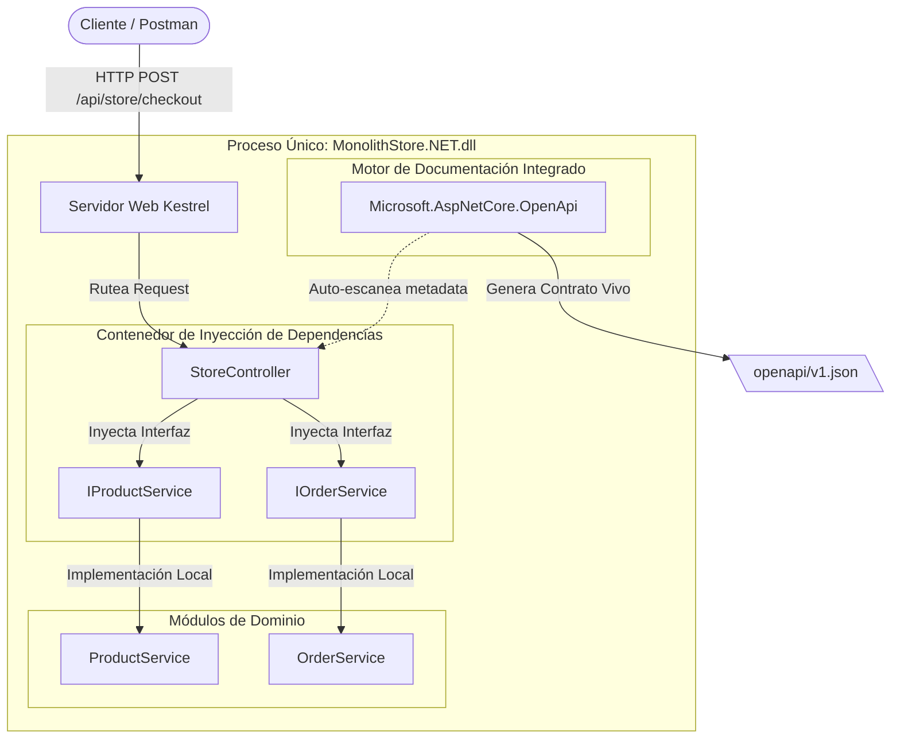
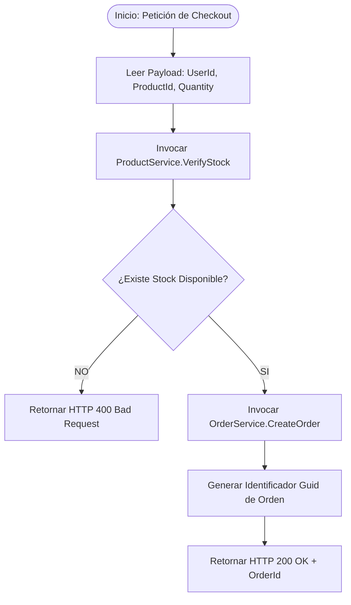
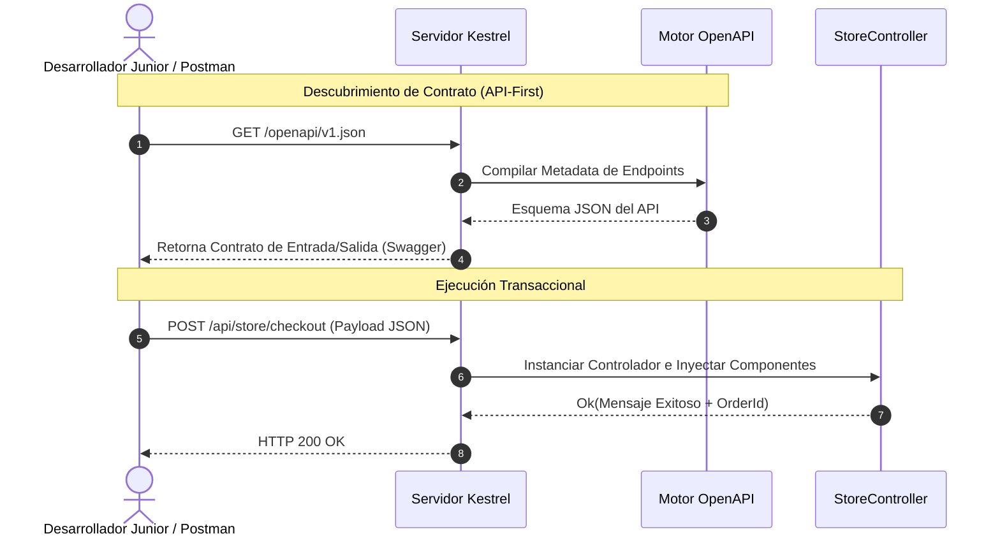

# Runbook de Capacitación - Fase 1: Arquitectura Monolítica de Alta Cohesión
**Ecosistema:** .NET 8 / 10 (ASP.NET Core Web API)  
**Host de Desarrollo:** Windows 10  
**Repositorio:** GitHub - RobValdes-Tech/architectures  

Este documento constituye una guía técnica detallada para desarrolladores Junior. Describe la construcción, inyección de dependencias, exposición de contratos OpenAPI y flujo de ejecución de una arquitectura monolítica modular en memoria.

---

## 📋 Índice del Runbook
1. [Vistas de Arquitectura y Diagramas](#1-vistas-de-arquitectura-y-diagramas)
2. [Guía de Implementación Paso a Paso](#2-guía-de-implementación-paso-a-paso)
3. [Runbook de Verificación y Smoke Tests](#3-runbook-de-verificación-y-smoke-tests)

---

## 1. Vistas de Arquitectura y Diagramas

### Diagrama de Arquitectura de Bloques C4


### Diagrama de Proceso de Negocio


### Diagrama de Secuencia de Integración (HTTP / OpenAPI)


---

## 2. Guía de Implementación Paso a Paso

### Paso 2.1: Inicialización con .NET CLI
```powershell
cd C:\Users\rob\proyectos\Tech-stack\architectures
mkdir 01_Phase_Monolithic
cd 01_Phase_Monolithic
dotnet new sln -n MonolithicArchitecture
dotnet new webapi -controllers -n MonolithStore.NET
dotnet sln MonolithicArchitecture.sln add MonolithStore.NET/MonolithStore.NET.csproj
```

### Paso 2.2: Configuración de Dependencias e Inyección (`Program.cs`)
```csharp
using MonolithStore.NET.Modules.Products;
using MonolithStore.NET.Modules.Orders;

var builder = WebApplication.CreateBuilder(args);

builder.Services.AddControllers();
builder.Services.AddEndpointsApiExplorer();
builder.Services.AddOpenApi();

builder.Services.AddScoped<IProductService, ProductService>();
builder.Services.AddScoped<IOrderService, OrderService>();

var app = builder.Build();

if (app.Environment.IsDevelopment())
{
    app.MapOpenApi();
}

app.UseHttpsRedirection();
app.UseAuthorization();
app.MapControllers();
app.Run();
```

### Paso 2.3: Exposición del Endpoint (`StoreController.cs`)
```csharp
using Microsoft.AspNetCore.Mvc;
using MonolithStore.NET.Modules.Products;
using MonolithStore.NET.Modules.Orders;

namespace MonolithStore.NET.Controllers
{
    [ApiController]
    [Route("api/store")]
    public class StoreController : ControllerBase
    {
        private readonly IProductService _productService;
        private readonly IOrderService _orderService;

        public StoreController(IProductService productService, IOrderService orderService)
        {
            _productService = productService;
            _orderService = orderService;
        }

        [HttpPost("checkout")]
        public IActionResult CompleteCheckout([FromBody] CheckoutRequest request)
        {
            var hasStock = _productService.VerifyStock(request.ProductId, request.Quantity);
            if (!hasStock) return BadRequest(new { Message = "No hay stock." });

            var orderId = _orderService.CreateOrder(request.UserId, request.ProductId, request.Quantity);
            return Ok(new { Message = "Éxito", OrderId = orderId });
        }
    }

    public class CheckoutRequest
    {
        public string UserId { get; set; } = string.Empty;
        public string ProductId { get; set; } = string.Empty;
        public int Quantity { get; set; }
    }
}
```

---

## 3. Runbook de Verificación y Smoke Tests

### Paso 3.1: Compilación y Ejecución
```powershell
dotnet build
dotnet run
```

### Paso 3.2: Inspección y Disparo HTTP
* **Contrato OpenAPI:** `http://localhost:5020/openapi/v1.json`
* **Petición de Prueba:** `POST http://localhost:5020/api/store/checkout`
```json
{
  "userId": "USR-737",
  "productId": "PROD-A10",
  "quantity": 3
}
```
