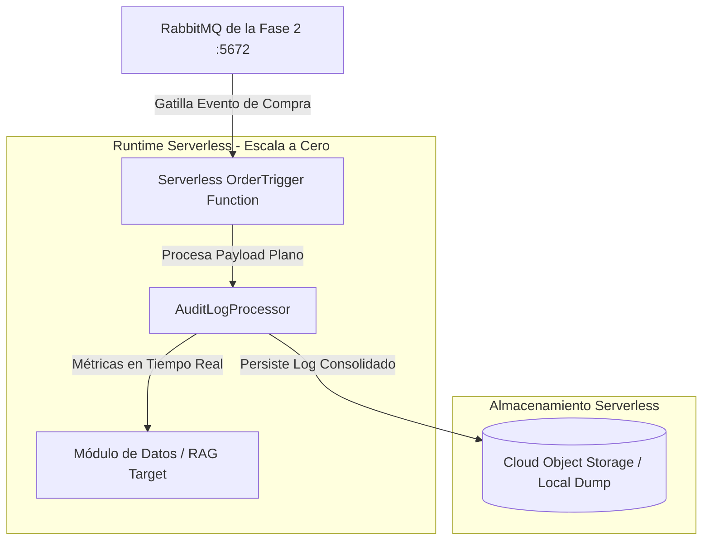

# Runbook de Capacitación - Fase 3: Arquitectura Serverless y Cómputo por Eventos
**Ecosistema:** Functions Framework (Node.js / Python / C#) Bajo Demanda  
**Host de Desarrollo:** Windows 10  
**Repositorio:** GitHub - RobValdes-Tech/architectures  

Este documento constituye una guía avanzada de ingeniería de software para capacitar desarrolladores Junior en el paradigma Serverless. Describe cómo aislar tareas intensivas de cómputo (Auditoría e Inteligencia de Datos) utilizando disparadores guiados por eventos en la nube.

---

## 📋 Índice del Runbook
1. [Vistas de Arquitectura Serverless](#1-vistas-de-arquitectura-serverless)
   * [Diagrama de Arquitectura C4 - Componentes Bajo Demanda](#diagrama-de-arquitectura-c4---componentes-bajo-demanda)
2. [Guía de Implementación del Runtime Serverless](#2-guía-de-implementación-del-runtime-serverless)
3. [Runbook de Verificación e Integración Distribuida](#3-runbook-de-verificación-e-integración-distribuida)

---

## 1. Vistas de Arquitectura Serverless

### Diagrama de Arquitectura C4 - Componentes Bajo Demanda
Muestra cómo las funciones escalan a cero cuando no hay transacciones en el bus, optimizando los costos de infraestructura a nivel empresarial.

### Estado de Avance del Ecosistema:
- [x] Arquitectura Monolítica Modular (Fase 1) completada y versionada.
- [x] Ecosistema de Microservicios Políglota y Persistencia Políglota (Fase 2) validados.
- [x] Estructura base física de la Fase 3 Serverless inicializada.
- [ ] Configuración del framework FaaS local e inyección de la lógica del disparador de auditoría.
