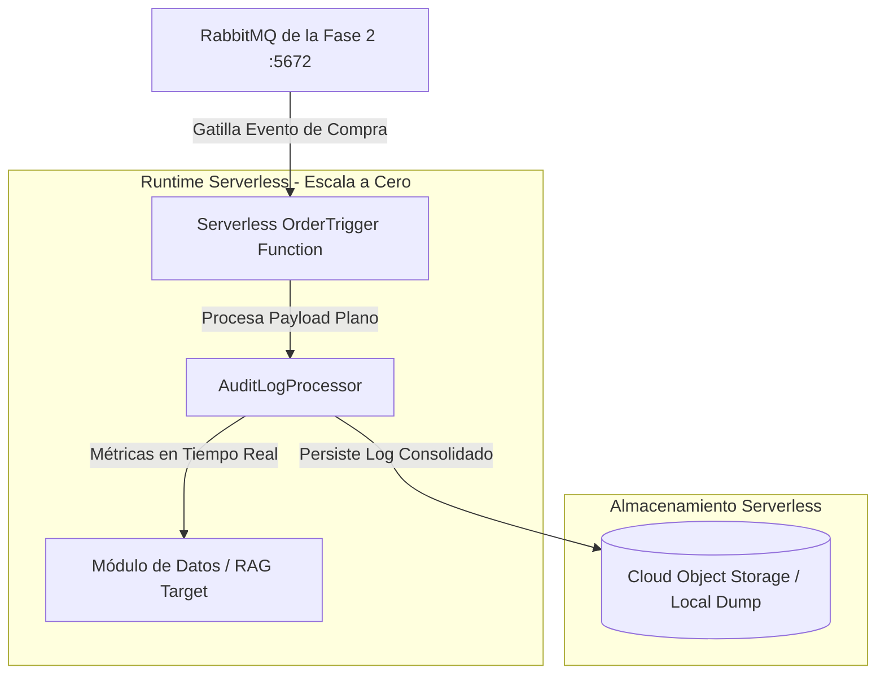

# Runbook de Capacitación - Fase 3: Arquitectura Serverless y Cómputo por Eventos
**Ecosistema:** Functions Framework (Node.js / JavaScript) Bajo Demanda  
**Host de Desarrollo:** Windows 10  
**Repositorio:** GitHub - RobValdes-Tech/architectures  

Este documento constituye una guía avanzada de ingeniería de software para capacitar desarrolladores Junior en el paradigma Serverless. Describe cómo aislar tareas intensivas de cómputo (Auditoría e Inteligencia de Datos) utilizando disparadores guiados por eventos en la nube.

---

## 📋 Índice del Runbook
1. [Vistas de Arquitectura Serverless](#1-vistas-de-arquitectura-serverless)
   * [Diagrama de Arquitectura C4 - Componentes Bajo Demanda](#diagrama-de-arquitectura-c4---componentes-bajo-demanda)
2. [Guía de Implementación del Runtime Serverless (FaaS)](#2-guía-de-implementación-del-runtime-serverless-faas)
   * [Paso 2.1: Inicialización del Módulo de Funciones](#paso-21-inicialización-del-módulo-de-funciones)
   * [Paso 2.2: Código de la Función de Auditoría (index.js)](#paso-22-código-de-la-función-de-auditoría-indexjs)
3. [Runbook de Verificación y Pruebas de Factibilidad](#3-runbook-de-verificación-y-pruebas-de-factibilidad)
   * [Paso 3.1: Comandos de Arranque del Emulador](#paso-31-comandos-de-arranque-del-emulador)
   * [Paso 3.2: Evidencia del Smoke Test de Integración](#paso-32-evidencia-del-smoke-test-de-integración)

---

## 1. Vistas de Arquitectura Serverless

### Diagrama de Arquitectura C4 - Componentes Bajo Demanda
Muestra cómo las funciones escalan a cero cuando no hay transacciones en el bus, optimizando los costos de infraestructura a nivel empresarial.



---

## 2. Guía de Implementación del Runtime Serverless (FaaS)

### Paso 2.1: Inicialización del Módulo de Funciones
```powershell
cd C:\Users\rob\proyectos\Tech-stack\architectures
mkdir 03_Phase_Serverless
cd 03_Phase_Serverless
npm init -y
npm install @google-cloud/functions-framework
```

### Paso 2.2: Código de la Función de Auditoría (`index.js`)
```javascript
const functions = require('@google-cloud/functions-framework');

functions.http('processAuditLog', (req, res) => {
    console.log('====== FUNCIÓN SERVERLESS GATILLADA BAJO DEMANDA ======');
    const orderData = req.body;
    
    if (!orderData || !orderData.productId) {
        return res.status(400).send({ status: 'Rechazado', error: 'Payload Invalido' });
    }

    res.status(200).send({
        status: 'Procesado',
        message: 'Log transaccional de auditoría registrado en el entorno Serverless.',
        timestamp: new Date().toISOString()
    });
});
```

---

## 3. Runbook de Verificación y Pruebas de Factibilidad

### Paso 3.1: Comandos de Arranque del Emulador
```powershell
npx @google-cloud/functions-framework --target=processAuditLog --port=8080
```

### Paso 3.2: Evidencia del Smoke Test de Integración
Petición de verificación realizada de forma exitosa en el entorno local emulado:
* **Método HTTP:** `POST`
* **URL:** `http://localhost:8080`
* **JSON Body enviado:**
```json
{
  "orderId": "b8f71fd2-8c4d-4e2a-9b1f-7a3c8e4d2f1a",
  "userId": "USR-Roberto73",
  "productId": "PROD-100",
  "quantity": 2
}
```

#### Respuesta Técnica Exitosa (HTTP 200 OK):
```json
{
  "status": "Procesado",
  "message": "Log transaccional de auditoría registrado en el entorno Serverless.",
  "timestamp": "2026-10-15T18:30:43.935Z"
}
```
---


### Paso 2.3: Script de Automatización de Despliegue
Se incorporó un script de orquestación en PowerShell para estandarizar el arranque del entorno FaaS local:
* `03_Phase_Serverless/run-serverless.ps1`: Automatiza la validación de dependencias `npm` e inicializa el runtime bajo demanda.

Para ejecutar el módulo de auditoría, el desarrollador Junior solo debe ingresar:
```powershell
.\run-serverless.ps1
```

## 📬 Coreografía de Eventos Serverless (Event-Driven)
Se incorporó un puente de integración políglota para conectar la topología AMQP con el paradigma FaaS:
* `03_Phase_Serverless/event-bridge.js`: Suscriptor desacoplado que escucha el Exchange de la Fase 2 y gatilla la ejecución de la función por cada transacción.

### Estado de Avance del Ecosistema:
- [x] Entorno Functions Framework local configurado.
- [x] Script `run-serverless.ps1` de arranque listo.
- [x] Puente de eventos asíncronos `event-bridge.js` integrado.
- [ ] Smoke Test completo del ecosistema (Monolito -> Microservicios -> Serverless).
