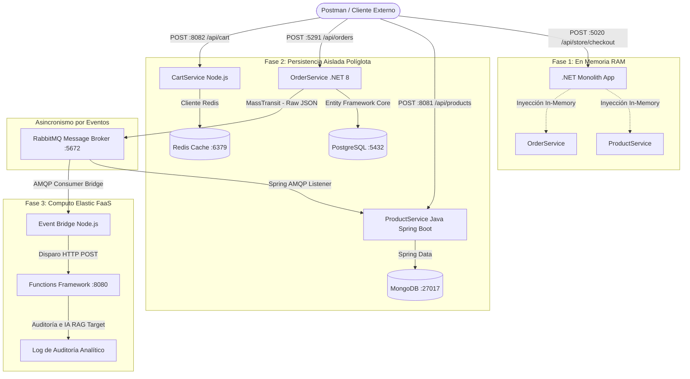

# Runbook de Arquitecturas Empresariales: Monolito a Microservicios & Serverless

**Organización / Portafolio:** RobValdes-Tech  
**Arquitecto Líder:** Roberto Azael Valdes Rodriguez  
**Host de Desarrollo:** Windows 10 Professional  
**Runtime Global:** .NET 8/10, Java 17 (Maven), Node.js (NPM), Docker Desktop (WSL2)  

Este repositorio constituye una suite de entrenamiento industrial y un laboratorio de co-existencia tecnológica diseñado para ingenieros de software Junior. Muestra la transición metodológica completa desde un monolito modular con inyección de dependencias en memoria, pasando por un ecosistema políglota de microservicios con persistencia aislada y mensajería distribuida, hasta culminar en un entorno FaaS Serverless asíncrono que escala a cero.

---

## 🗺️ Mapa de Navegación del Ecosistema
1. [🏛️ Arquitectura Global del Ecosistema Integrado](#🏛️-arquitectura-global-del-ecosistema-integrado)
2. [📦 Fase 1: Arquitectura Monolítica Modular](#📦-fase-1-arquitectura-monolítica-modular)
3. [🔵 Fase 2: Ecosistema de Microservicios Políglotas](#🔵-fase-2-ecosistema-de-microservicios-políglotas)
4. [⚡ Fase 3: Procesamiento Serverless Guiado por Eventos](#⚡-fase-3-procesamiento-serverless-guiado-por-eventos)
5. [🐳 Orquestación de Infraestructura y Topología de Red (Docker)](#🐳-orquestación-of-infraestructura-y-topología-de-red-docker)
6. [📋 Guía Unificada de Ejecución del Sistema Completo (5 Ventanas)](#📋-guía-unificada-de-ejecución-del-sistema-completo-5-ventanas)
7. [🔧 Bitácora de Ingeniería Histórica: Errores Comunes y Soluciones (Troubleshooting)](#🔧-bitácora-de-ingeniería-histórica-errores-comunes-y-soluciones-troubleshooting)

---

## 🏛️ Arquitectura Global del Ecosistema Integrado

El sistema completo modela el ciclo de vida de una transacción de compra de punta a punta. A medida que avanzamos a través de las fases, las capacidades del monolito se fracturan y delegan de manera desacoplada e interoperable.



---

## 📦 Fase 1: Arquitectura Monolítica Modular

### Enfoque de Ingeniería
Se construyó un sistema acoplado en un único hilo de ejecución donde los componentes se comunican a través de punteros de memoria dentro de la memoria RAM del host. Se aplicaron los principios SOLID mediante inversión de dependencias utilizando interfaces explícitas. Se dio máxima relevancia al uso de **OpenAPI / Swagger** como contrato vivo de software y puerta de entrada para el descubrimiento del sistema.

### Directorios Lógicos
* `01_Phase_Monolithic/MonolithStore.NET/Program.cs`: Pipeline único IoC y Middleware HTTP.
* `01_Phase_Monolithic/MonolithStore.NET/Modules/Products/IProductService.cs`: Interfaz e implementación de stock en memoria.
* `01_Phase_Monolithic/MonolithStore.NET/Modules/Orders/IOrderService.cs`: Interfaz e implementación de transacciones.
* `01_Phase_Monolithic/MonolithStore.NET/Controllers/StoreController.cs`: Controller clásico que acopla las dependencias y expone el contrato REST.

### Comandos de Construcción y Ejecución
```powershell
cd C:\Users\rob\proyectos\Tech-stack\architectures\01_Phase_Monolithic
dotnet new sln -n MonolithicArchitecture
dotnet new webapi -controllers -n MonolithStore.NET
dotnet sln MonolithicArchitecture.sln add MonolithStore.NET/MonolithStore.NET.csproj
cd MonolithStore.NET
dotnet build
dotnet run
```
* **Contrato de OpenAPI Vivo:** `http://localhost:5020/openapi/v1.json`

---

## 🔵 Fase 2: Ecosistema de Microservicios Políglotas

### Enfoque de Ingeniería
Se fracturó el monolito dividiendo los dominios funcionales en diferentes runtimes desacoplados. Se implementó una **Arquitectura de Persistencia Políglota Dedicada**, rompiendo el acoplamiento compartido de base de datos. La comunicación entre el emisor (.NET) y el receptor (Java) se ejecuta de forma asíncrona a través de RabbitMQ, utilizando contratos de datos inmutables y serialización JSON plana pura sin metadatos propietarios para garantizar interoperabilidad políglota transparente.

### Estructura del Ecosistema de Software
* **`ProductService.Java` (Spring Boot + MongoDB + Spring AMQP):** Consume los eventos de compra e impacta de manera reactiva reduciendo el inventario documental.
* **`OrderService.Net` (.NET 8 + PostgreSQL + MassTransit):** Recibe compras en el endpoint HTTP, persiste de forma relacional y publica el evento inmutable `OrderCreatedEvent`.
* **`CartService.Node` (Node.js + Express + Redis Cache):** Inicializado de forma estructural en el puerto `8082` para operar como el puente de entrada y almacenamiento efímero clave-valor en caché de alta velocidad.

---

## ⚡ Fase 3: Procesamiento Serverless Guiado por Eventos

### Enfoque de Ingeniería
Se aisló el procesamiento pesado de auditoría y análisis de datos mediante el paradigma FaaS (*Function-as-a-Service*), garantizando que los recursos de cómputo escalen a cero de forma absoluta cuando no existen transacciones en tránsito en el bus de datos. Se emuló localmente mediante **Google Functions Framework para Node.js**.

### Componentes de Software Desarrollados
* `03_Phase_Serverless/index.js`: Código fuente de la función Serverless HTTP encargada de consolidar los logs analíticos de compra.
* `03_Phase_Serverless/event-bridge.js`: Puente conector políglota (`amqplib` + `axios`) que consume los mensajes de RabbitMQ y despierta la función Serverless inyectando el payload.
* `03_Phase_Serverless/run-serverless.ps1`: Script de automatización de entorno para desarrolladores Junior.

---

## 🐳 Orquestación de Infraestructura y Topología de Red (Docker)

Se unificó la administración del clúster de infraestructura local en un único manifiesto localizado bajo la ruta `02_Phase_Microservices/docker-compose.yml`. Todos los servicios se inyectan en un puente de red común y exponen sus puertos al host de Windows con el formato estricto de comillas dobles para evitar bloqueos del demonio de red.

### Archivo Completo de Infraestructura (`docker-compose.yml`)
```yaml
version: '3.8'

services:
  products-db:
    image: mongo:6.0
    container_name: products-mongodb
    restart: always
    ports:
      - "27017:27017"
    environment:
      MONGO_INITDB_ROOT_USERNAME: dbuser
      MONGO_INITDB_ROOT_PASSWORD: dbpassword123!
      MONGO_INITDB_DATABASE: ProductsDb
    volumes:
      - mongodb_data:/data/db

  orders-db:
    image: postgres:15-alpine
    container_name: orders-postgres
    restart: always
    ports:
      - "5432:5432"
    environment:
      POSTGRES_USER: postgres
      POSTGRES_PASSWORD: SecretPassword123!
      POSTGRES_DB: OrdersDb
    volumes:
      - postgres_data:/var/lib/postgresql/data

  cart-cache:
    image: redis:7-alpine
    container_name: cart-redis
    restart: always
    ports:
      - "6379:6379"
    volumes:
      - redis_data:/data

  rabbitmq:
    image: rabbitmq:3-management-alpine
    container_name: global-rabbitmq
    restart: always
    ports:
      - "5672:5672"
      - "15672:15672"
    environment:
      RABBITMQ_DEFAULT_USER: guest
      RABBITMQ_DEFAULT_PASS: guest

volumes:
  mongodb_data:
  postgres_data:
  redis_data:
```

### Modelado de Esquemas Físicos (DDL y Documentos)

#### 1. Esquema Relacional de Órdenes (PostgreSQL)
```sql
CREATE TABLE orders (
    id uuid NOT NULL,
    user_id character varying(255) NOT NULL,
    product_id character varying(255) NOT NULL,
    quantity integer NOT NULL,
    created_at timestamp with time zone NOT NULL,
    CONSTRAINT "PK_orders" PRIMARY KEY (id)
);
```

#### 2. Estructura de Documento de Catálogo (MongoDB)
```json
{
  "_id": "PROD-100",
  "name": "Hoka Clifton 13 Wide",
  "price": 140.00,
  "stock": 50
}
```

---

## 📋 Guía Unificada de Ejecución del Sistema Completo (5 Ventanas)

Para validar la coreografía distribuida políglota de extremo a extremo, el desarrollador Junior debe abrir **5 ventanas independientes de PowerShell** de forma simultánea en Windows 10:

* **Ventana 1 (Infraestructura):** `cd 02_Phase_Microservices; docker-compose up -d`
* **Ventana 2 (Java - Catálogo):** `cd 02_Phase_Microservices\ProductService.Java; mvn spring-boot:run`
* **Ventana 3 (.NET - Órdenes):** `cd 02_Phase_Microservices\OrderService.Net\OrderService.Net; dotnet run`
* **Ventana 4 (Serverless FaaS):** `cd 03_Phase_Serverless; .\run-serverless.ps1`
* **Ventana 5 (Puente AMQP):** `cd 03_Phase_Serverless; node event-bridge.js`

